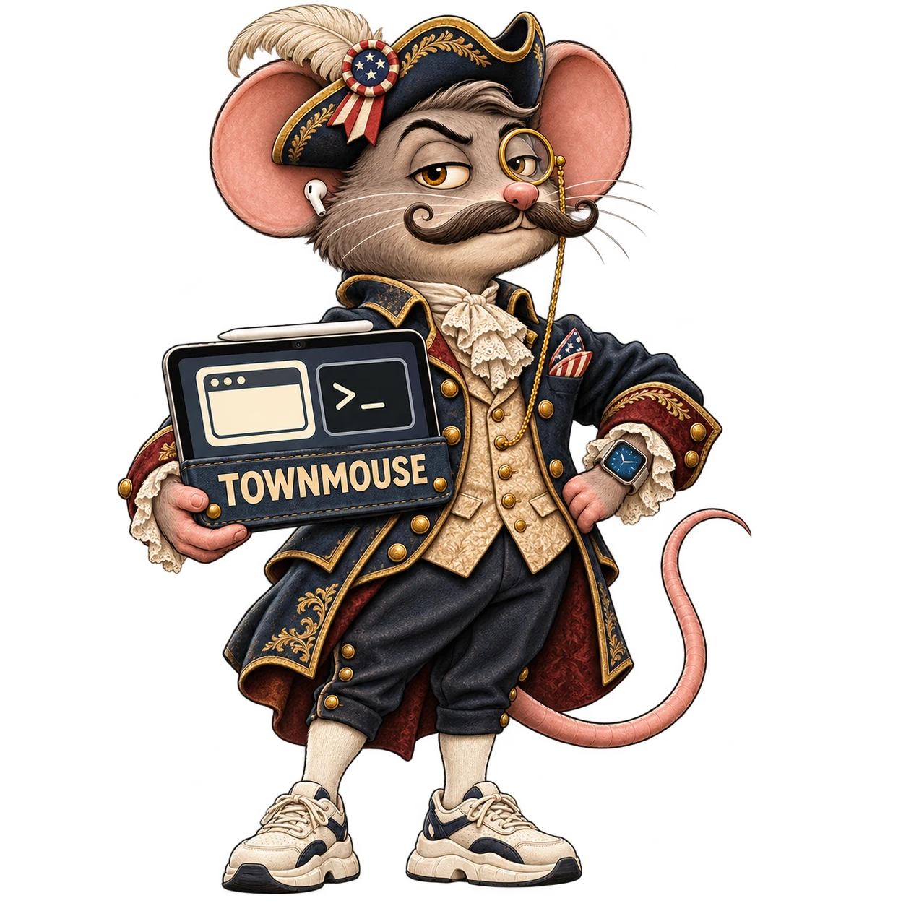

# Townmouse

## Or: The terminal is the house. The browser is the town. The mouse runs both.



**DOCUMENT CLASSIFICATION:** PRODUCT README / CAFFEINATED / ANTI-CORPORATE  
**DATE RECORDED:** 2026-11-15 — 2:47 AM, because that is when the real work happens  
**LOCATION:** The garage, Brown County, Indiana  
**BEVERAGE:** Coffee that tastes like motor oil (fresh pot)  
**CAT SUPERVISION:** Bella on quality assurance; Bowser monitoring the routers  
**CURRENT STATE:** Terminal open, browser open, no subscription in sight

Townmouse is a terminal and agent browser workspace that runs on your own
machine. A live PTY shell and live Chromium pages share one workspace. You can
work in both. So can an agent. No hosted dashboard, no per-seat invoice, no
"contact sales" button lurking behind the terminal.

This is local software: a Node server and a static front end. The server listens
on `127.0.0.1` at port 11001 by default, and anything the terminal runs has your
account's authority. That is the deal. Treat it like a loaded shell, because it
is one.

## What it does (Or: Fewer tabs, more work)

- **Terminal.** A real PTY with your shell, session resume, the key bar, themes,
  and the existing terminal feature modules. The session pill opens a switcher
  with every named shell and a New session action. The footer shows the shell,
  working directory, and uptime. The terminal does not pretend to be a text box.
- **Pane workspace.** The native path for agent work. Open `/panes.html` for a
  2x2 grid of up to four live panes per tab, each one a terminal or a browser
  page. The orchestrator agent creates and drives them through the injected
  `TOWNMOUSE_API` and `scripts/panes` interface. No connection code is copied
  between the browser and the terminal. Browser viewports reflow to the pane,
  and dropped or pasted files upload once and arrive in the terminal as a real
  path.
- **Browser.** Real Chromium pages on the terminal host, each in its own context
  with its own cookies, not an iframe wearing a trench coat. The pane workspace
  is the native way to use them; the single-browser workspace remains for
  compatibility.
- **Agent browser.** A separate context with control granted. Hide view keeps it
  running headless; reopen Agent to observe the same context. In the pane
  workspace, the agent gets native access through the injected environment. The
  single-browser view keeps its bearer-token path for compatibility.
- **Three layouts.** Desktop sidebar, tablet rail, phone bottom navigation. The
  phone shows one task surface at a time; its key bar collapses to one row and
  expands on demand. After seven seconds without a touch, the phone chrome drops
  away except the bottom navigation. The next touch wakes it. No mystery meat
  chrome.
- **Installable.** Add it to the home screen on iPad or iPhone. The shell and
  workspace load from the local server. Offline coverage is the shell only; live
  PTYs and browser pages still need the server.

## Requirements (Or: The parts you actually need)

Node.js 22.x (preferred; 22–26 are accepted) and npm on macOS or Linux. Puppeteer
is a production dependency because browser tabs and panes are real Chromium
pages; `npm ci` downloads a compatible Chromium. If that download is skipped —
npm 12 skips dependency install scripts by default — TownMouse falls back to an
installed Chrome, Chromium, Edge, or Brave. Set `TERMINALONE_CHROME` to choose a
specific binary. `GET /health` reports which engine resolved.

On Linux, npm 12 skips dependency install scripts by default and node-pty has no
prebuilt Linux binary; install with `--allow-scripts=node-pty`, or run
`npm rebuild node-pty`, then `npm run doctor`. The container needs neither.

`npm run doctor` checks the Node version and native modules. If `node-pty`
needs rebuilding, `npm run repair` does that. The engine is native code; it is
not going to apologize for needing a compiler.

## Run it (Or: Four doors, one room)

### From source (Or: The workbench)

```sh
git clone https://github.com/CaptainPhantasy/townmouse.git
cd townmouse
npm ci
npm start
```

Open `http://localhost:11001`. The server binds to `127.0.0.1`. A terminal can
run commands with your account's permissions; keep the server on loopback
unless you have an authenticated proxy in front.

### From npm (Or: The package is the product)

```sh
npm install -g townmouse
townmouse --version
townmouse                       # starts the server and opens the workspace
townmouse --port 12000 --no-open
```

`npx townmouse` runs it without a global install. The command starts the server,
prints the URL, and opens a browser unless `--no-open` is passed; `--help` and
`--version` do what they say.

The first run creates `~/.townmouse` (mode 0700) holding the workspace token
(mode 0600) and the attachment tree. Back that directory up before upgrades; it
is the part that is yours.

```sh
npm run doctor     # Node version and native modules
npm run repair     # rebuild node-pty if the engine and the runtime disagree
```

On Linux with npm 12, dependency install scripts are skipped by default and
node-pty has no Linux prebuild. Allow the build, or rebuild afterwards, then
check:

```sh
npm install -g --allow-scripts=node-pty townmouse
# or, in an existing install:
npm rebuild node-pty
npm run doctor
```

If the terminal engine cannot load, the server says so and names those remedies
instead of printing a stack trace.

Upgrade, roll back, uninstall:

```sh
npm install -g townmouse@latest     # upgrade
npm install -g townmouse@0.2.1      # roll back to a known version
npm rm -g townmouse                 # uninstall
```

Data is compatible within a minor version. A breaking data change would get a
migration note, not a shrug.

### From the release tarball (Or: When the registry is not the route)

Every release attaches the exact tarball and its checksum, byte for byte the
same artifact the registry serves:

```sh
VERSION=0.2.1   # set to the release you want
curl -LO "https://github.com/CaptainPhantasy/townmouse/releases/download/v$VERSION/townmouse-$VERSION.tgz"
curl -LO "https://github.com/CaptainPhantasy/townmouse/releases/download/v$VERSION/SHA256SUMS"
shasum -a 256 -c SHA256SUMS
npm install -g "./townmouse-$VERSION.tgz"
```

### With Docker (Or: The room in a box)

```sh
TOWNMOUSE_VERSION=$(node -p "require('./package.json').version") \
  GIT_REVISION=$(git rev-parse HEAD) \
  docker build \
    --build-arg TOWNMOUSE_VERSION="$TOWNMOUSE_VERSION" \
    --build-arg GIT_REVISION="$GIT_REVISION" \
    -t townmouse:"$TOWNMOUSE_VERSION" \
    -t townmouse:latest .
docker run --rm -p 127.0.0.1:11001:11001 \
  -v townmouse-home:/home/node/.townmouse \
  -v townmouse-config:/home/node/.config/terminalone \
  townmouse:latest
```

The image carries Open Container labels for its version and the exact commit it
was built from, so an image can be traced back to the source. It is built
locally today; a registry tag will be added when the registry is chosen.

The image uses `node:22-bookworm-slim` and installs Chromium. The volume holds
the workspace data. Mount project directories explicitly; the terminal starts
in `/home/node`. `GET /health` returns `status: "ok"`.

Inside the container the server listens on `0.0.0.0` so Docker can forward the
port; the `-p 127.0.0.1:...` above is what keeps it off your network. Do not
publish it on `0.0.0.0` without an authenticated HTTPS proxy. Chromium runs
without its sandbox in this image because the container has no user namespace
setup for it; treat the image as a trusted single-user boundary.

## Use it from a phone or tablet (Or: The tailnet is the front door)

The app installs from the browser on iPad or iPhone. The workspace and terminal
shell come from the local server; live PTYs and browser pages need it running.

Do not expose the raw loopback server. Put an HTTPS proxy or tunnel in front
that requires you to sign in before it forwards **any** request, including
WebSocket connections. Start Townmouse with the exact public address:

```sh
TERMINALONE_TRUSTED_ORIGINS=https://townmouse.example.com npm start
# or, from an installed package:
TERMINALONE_TRUSTED_ORIGINS=https://townmouse.example.com townmouse --no-open
```

The proxy must forward to `http://127.0.0.1:11001`, preserve the public `Host`
header and browser `Origin`, and support WebSocket upgrades. The setting takes
exact HTTPS origins separated by commas; wildcards, paths, embedded credentials,
and plain HTTP remote addresses are rejected. It allows an address. It does not
add authentication. Keep the server on loopback and let the proxy do the
sign-in.

On a tailnet, publish with `tailscale serve` on a claimed port bound to
loopback. Never expose it with Funnel without explicit approval. The mesh is the
gate; the server is not the gate.

## The pane workspace (Or: Four panes, one token, zero codes to copy)

The pane workspace is the native path for agent work. Open `/panes.html`,
`/panes`, or **Panes** in the workspace sidebar.

A workspace tab holds up to four panes in a 2x2 grid. Each pane is a live PTY
terminal or a live headless-browser page. Tabs are created by the human or by
the orchestrator, and every tab can hold a different mix. The server caps the
workspace at 24 tabs and four panes per tab, with 24 terminal panes. The browser
runtime caps open browser contexts at 32. That gives a runaway agent a ceiling
before it gives the machine a funeral.

### For a person (Or: The controls you actually touch)

**Tabs** in the bottom bar lists, switches, creates, and closes workspace tabs.
**Menu** adds a terminal or browser pane, opens Reader, adjusts terminal text,
or shows the shortcut sheet. **Keyboard** focuses the active terminal; in a
browser pane it focuses the page-type field. `Alt+T` creates a tab, `Alt+1..9`
selects one, `Alt+Arrow` moves pane focus, `Alt+Shift+Arrow` reorders a pane,
`Alt+M` maximizes (the pane header also carries a visible maximize/restore control), and `Alt+W` asks before closing the active pane. Drag a pane
header to reorder it, or drag the divider between panes to resize them.

Browser panes accept clicks, wheel scrolling, touch-drag scrolling, typing,
Back, Forward, Reload, and an address. The browser is a real Chromium page
rendered by the server, and its viewport reflows to the pane's actual size so
text wraps at the pane edge. `alert`/`confirm`/`prompt` dialogs wait for an
answer in a pane card (or `panes pane dialog`) instead of deadlocking the page.

Drop or paste a file or image onto a terminal pane. The file is uploaded once
into the state directory's `attachments/<date>/` tree (25 MB per request; daily
quota; old buckets archived), and a shell-quoted absolute path is inserted into
the PTY; the terminal never receives a base64 stream. The attachment card shows
the path and URL, and the browser pane can open the loopback URL. This is the
drag-and-drop people have expected since roughly 1995.

### For an agent (Or: The environment is the handshake)

Each terminal pane is spawned with:

```text
TOWNMOUSE_API=http://127.0.0.1:<port>/api/panes
TOWNMOUSE_TOKEN=<workspace token>
TOWNMOUSE_TAB_ID=<this tab>
TOWNMOUSE_PANE_ID=<this pane>
TOWNMOUSE_PANES_CLI=<repo>/scripts/panes
```

No code is copied between the browser and the terminal. Run the CLI directly:

```bash
"$TOWNMOUSE_PANES_CLI" guide
"$TOWNMOUSE_PANES_CLI" state
"$TOWNMOUSE_PANES_CLI" tab create --title "Second workspace"
"$TOWNMOUSE_PANES_CLI" pane create --kind terminal
"$TOWNMOUSE_PANES_CLI" pane create --kind browser --url https://example.com
"$TOWNMOUSE_PANES_CLI" pane exec <pane-id> -- "npm test"       # tracked job, exit code
"$TOWNMOUSE_PANES_CLI" pane run <pane-id> "npm test"           # typed line, unconfirmed
"$TOWNMOUSE_PANES_CLI" pane wait <pane-id> --match "PASS" --timeout 60000
"$TOWNMOUSE_PANES_CLI" pane read <pane-id> --lines 120         # clean screen text
"$TOWNMOUSE_PANES_CLI" pane read <pane-id> --raw
"$TOWNMOUSE_PANES_CLI" pane browser observe --elements
"$TOWNMOUSE_PANES_CLI" pane browser click --ref e12
"$TOWNMOUSE_PANES_CLI" pane browser type --ref e12 --replace "café 東京"
"$TOWNMOUSE_PANES_CLI" pane browser key Alt+M
"$TOWNMOUSE_PANES_CLI" pane browser scroll --ref e12 --dy 400
"$TOWNMOUSE_PANES_CLI" pane browser wait --text "Saved" --timeout 10000
"$TOWNMOUSE_PANES_CLI" pane browser sizing fixed --width 1280 --height 800
"$TOWNMOUSE_PANES_CLI" pane status <pane-id> --state blocked
"$TOWNMOUSE_PANES_CLI" pane text <pane-id>
"$TOWNMOUSE_PANES_CLI" attach ./screenshot.png --pane <pane-id>
```

`panes guide` prints the instruction sheet an agent gets on connect: every tool,
what it needs, what it returns, and what this connection may not do. `pane
create` defaults to the current tab; a tab holds up to four panes and can mix
terminals and browsers freely.

`pane exec` runs one non-interactive command as a tracked job and returns its id,
status, exit code, and output; `pane job` reads it again. `pane run` types into
the interactive terminal and does not prove the command finished. `pane read`
returns clean screen text; `--raw` keeps the original escape data. `pane wait`
blocks on text, a regex, an idle interval, or an agent-reported state, always
with a timeout. Regex patterns run in a worker thread with a deadline, so a
pathological pattern is refused instead of stalling the server.

Browser panes are driven by ref from `pane browser observe --elements`: role,
name, value, state, and box, across cross-origin frames and open shadow roots.
Coordinate clicks still work. Every action reports completed, missing,
wrong-kind, failed, stale, or unconfirmed, and a target from a changed page is
refused with "look again". `pane text` reads the page's visible text and says
when it was cut short.

Status is three separate facts, not one badge: the program is running or exited;
the agent last reported a state (with the age of that report); and the last
tracked command has its own result. `attach` uploads with the scoped pane token
and prints the path and URL.

The workspace survives a server restart: tab titles, pane kinds, terminal
working directories, browser URLs, pane order, and the active tab are saved in
`~/.townmouse/workspace.json`. The PTYs start fresh, because a shell process
does not survive its server. The layout does; the client sees a new epoch and
is told that scrollback and running jobs were not restored.

## The single-browser workspace (Or: The compatibility wing)

The pane workspace is the native path. The original single-browser workspace
remains for compatibility: the terminal surface, a tab strip of browser tabs,
and a separate agent browser.

Open **Browser** or a new tab. Enter a web address, search phrase, or localhost
URL. Navigation, clicks, typing, and scrolling happen in the real page on the
terminal host, not in an iframe.

Human tabs start Private. **Share** opens the permission row at every width -
View only, Allow control, Copy connection, Read page, Close tab - and it starts
closed so the page keeps the space. Changing the permission rotates the token;
choosing Private rejects subsequent token requests; closing a tab destroys its
context. A **Collapse** control removes every bar above the page and remembers
the choice, leaving a slim strip that names the page and brings the controls
back. The mascot stays in the navigation rail. On a phone, the tab strip,
address bar, and type row sit at the bottom above the remote keyboard; the
address bar carries back, forward, reload, and Go.

The agent browser is a separate context with control granted. Hide view keeps it
running headless; reopen Agent to observe the same context. Its bearer-token API
is documented in [docs/browser-workspace.md](docs/browser-workspace.md). For
agent work in the pane workspace, use the injected environment and
`scripts/panes` instead; there is no connection code to copy.

## Security and limits (Or: Bad news first, then the receipts)

- The terminal runs with your account's permissions. Keep the server on loopback
  unless an authenticated proxy is in front.
- Browser tabs and panes are isolated Chromium contexts with their own cookies,
  not your personal Safari or Chrome profile. They are not a security boundary
  against a process that already has unrestricted access to the host.
- Grants protect cooperative API clients. They do not protect against a hostile
  process with host access.
- Browser sessions and grants live in memory. Restarting the server closes them;
  saved browser profiles and seamless session persistence are not implemented.
- Browser audio, native file-picker and download dialogs, extensions, and
  password-manager integration are not provided. Dropped files use the
  attachment path above.
- The browser viewer is image-based: it is remote interaction, not a native DOM
  exposed to the viewer's assistive technology.
- Password fields are never returned in an element catalog, including to
  view-only grants. The agent can focus and type into them without reading the
  value.

### Your data (Or: The files that stay yours)

Workspace data lives in `~/.townmouse`:

- `pane-token` — the workspace API token, mode 600.
- `attachments/<date>/` — dropped files, mode 700/600.
- `workspace.json` — tabs, panes, URLs, and the active tab, mode 600.
- `~/.config/terminalone/voice.json` — voice command, model, language, and
  arguments, mode 600. Outside `~/.townmouse`, so a Docker run mounts it as the
  second volume.

Back up `~/.townmouse` before upgrades. Project files live wherever you mounted
them, never inside the package directory. Docker uses the `townmouse-home`
volume for the same data.

## Development (Or: Tests before vibes)

```sh
npm start              # run the workspace
npm test               # security, unit, smoke, feature, voice, responsive, pane API, and agent-control suites
npm run test:workspace # browser workspace journeys; starts its own preview site
npm run test:package   # install the packed tarball and run the installed app
# Releases: merging a version bump to main runs .github/workflows/publish.yml,
# which publishes with npm Trusted Publishing (no stored token) once configured.
npm run doctor         # check Node and native modules
npm run repair         # rebuild native modules
```

Design notes live in [DESIGN.md](DESIGN.md). The product follows the Legacy
Design Studio's Frontend Design workflow, with the Open Design anti-AI-slop
review as its supplemental checklist.

More docs:

- [docs/panes.md](docs/panes.md) — pane workspace and agent CLI.
- [docs/browser-workspace.md](docs/browser-workspace.md) — browser tabs and the legacy bearer-token API.
- [docs/PACKAGING.md](docs/PACKAGING.md) — npm, Docker, the macOS wrapper, release gates, and backup.
- [TOWNMOUSE.md](TOWNMOUSE.md) — product boundary and origin.

## Status (Or: Version 0.2.1, and honest about it)

Version 0.2.1. 0.1.0 was the first product cut. Available from npm as
`townmouse@0.2.1`, as a checksummed tarball on the GitHub release, and as a
locally built container image. Two working surfaces: the single terminal/browser
workspace and the pane workspace. The pane workspace is the
native path for agent work; the single-browser workspace remains for
compatibility. Known limits are under Security and in
[docs/PACKAGING.md](docs/PACKAGING.md).

## Terminal engine (Or: The engine stays in the engine bay)

The terminal is TerminalOne, the canonical standalone PTY from Floyd’s Labs,
embedded in Townmouse. The terminal surface — PTY, session resume, key bar,
themes, and feature modules — comes from the engine. Townmouse owns the browser
workspace, agent browser, view/control grants, the pane system, and the
interface. Browser-workspace features do not go upstream into TerminalOne. See
[TOWNMOUSE.md](TOWNMOUSE.md) for the product boundary and origin.

## Credits (Or: The cats get a logo, not the product)

Built at [Floyd’s Labs](https://floydslabs.com). The creator credit in the app
uses the Floyd’s Labs neon-cats mark. Bella and Bowser did not review this README,
but Bella walked across the keyboard at least once, which counts as QA.

## License (Or: The give-back rule)

AGPL-3.0-only. If you run Townmouse, or a modified version of it, as a network
service, you must offer the complete corresponding source to the people who use
it. Distributing it also requires the source. TerminalOne's license and
copyright notices remain with the portions it supplies.

### Why AGPL-3.0-only (Or: Because the subscription treadmill can keep walking)

At Floyd’s Labs we build local tools that should stay useful to the people who
run them. We release Townmouse under the GNU Affero General Public License v3,
and only v3, for three plain reasons:

- **Open Exchange.** The work should be available to independent developers,
  self-hosters, and hobbyists for personal and local use.
- **The Give-Back Rule.** If you modify Townmouse and expose it as a network
  service, the AGPL requires you to offer your modified source under the same
  terms.
- **Passive Protection.** The license keeps self-funded lab work a shared asset.
  A proprietary service cannot build on Townmouse without making its modified
  source available under the same terms.

That is the point. Nobody gets to take the garage work, put a Patagonia vest on
it, and charge rent for the terminal.

---

┌──────────────────────────────────────────────────────────┐
│  DOCUMENT METADATA                                        │
├──────────────────────────────────────────────────────────┤
│  Classification:   Product README / Floyd's Labs           │
│  Cat Supervision:  Bella approved; Bowser monitoring       │
│  "I Don't Suck":   PASS                                    │
│  Corporate Feelings: HURT (intended)                       │
└──────────────────────────────────────────────────────────┘

**DOCUMENT ENDS**

*— The Garage, Product Documentation Division*  
*Floyd’s Labs — Brown County, Indiana*  
*“The terminal is the house. The browser is the town. The mouse is the product.”*
